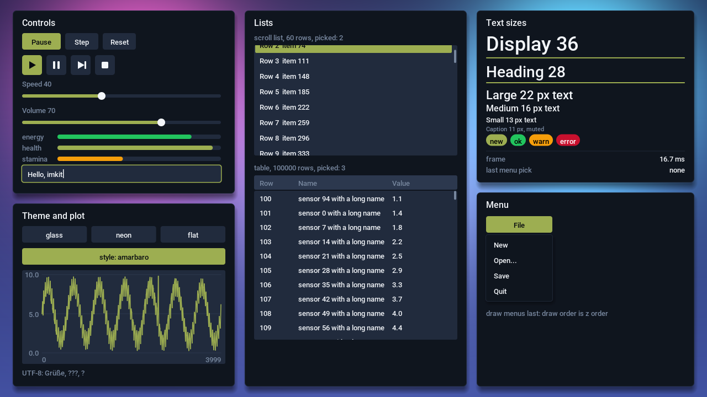
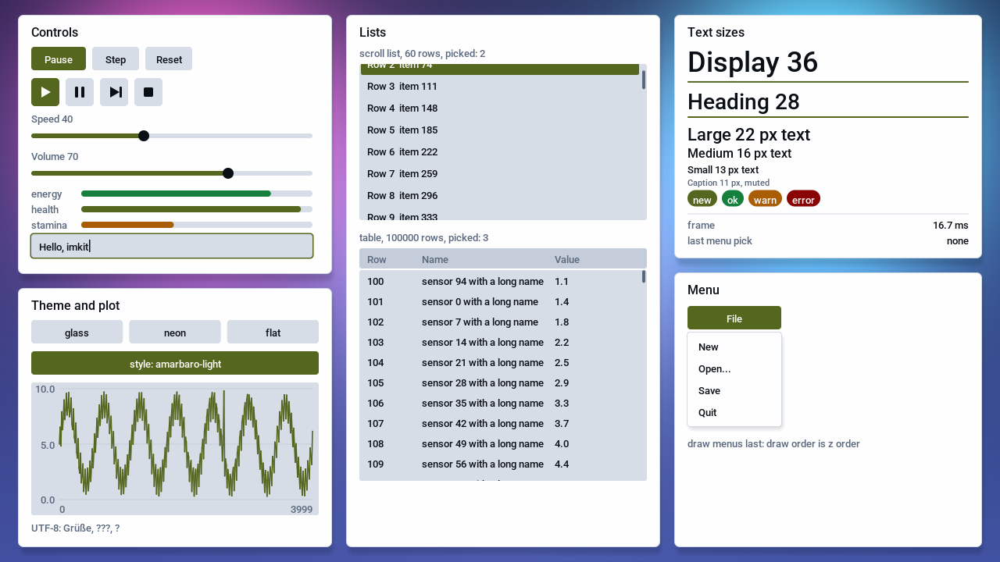
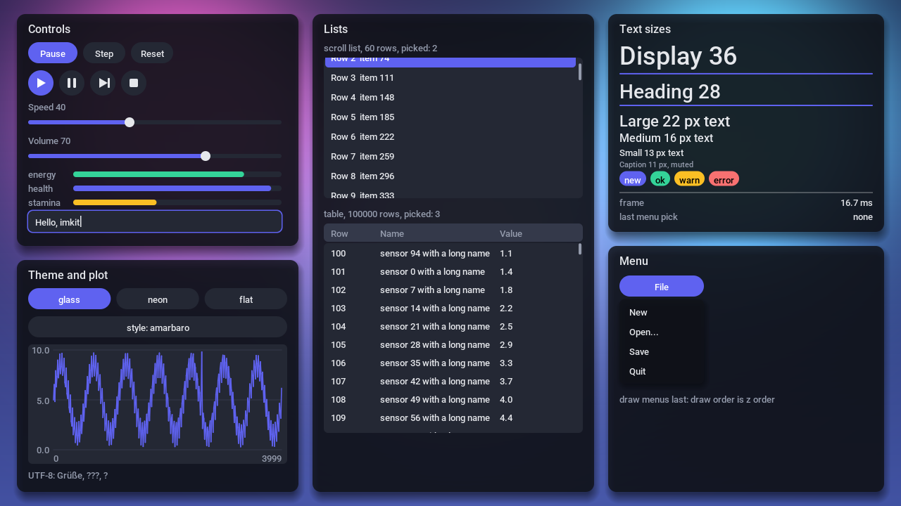
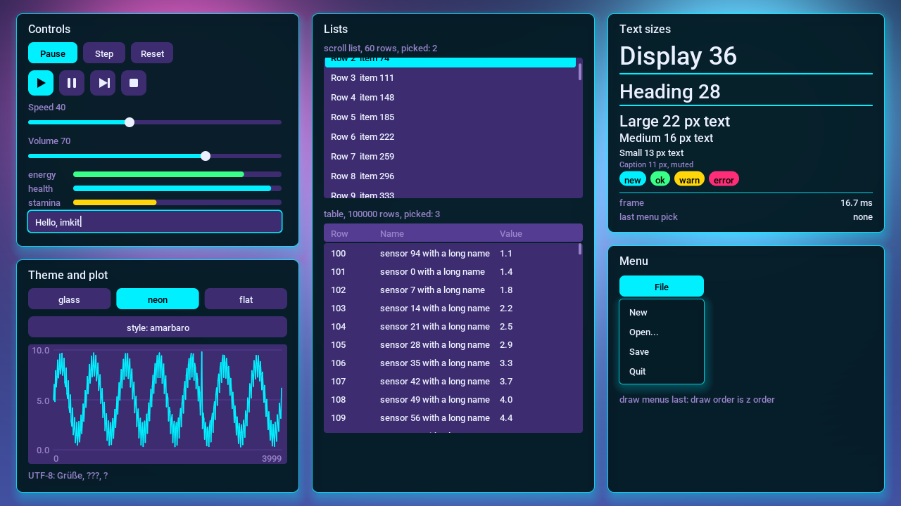
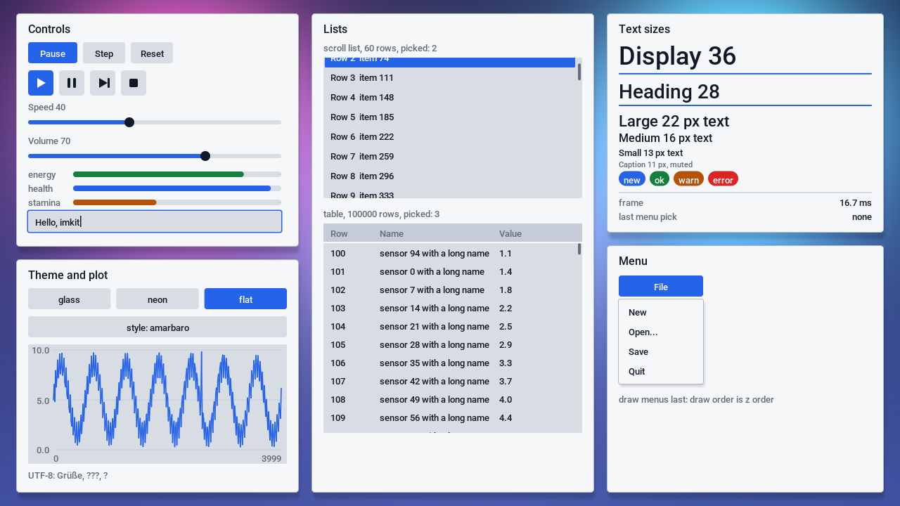
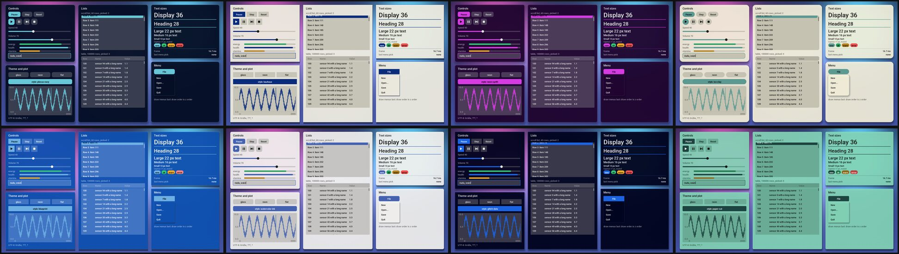

# mojo-imkit

<!-- badges -->
[](https://github.com/amarbaro/mojo-imkit/actions/workflows/ci.yml) [](https://github.com/amarbaro/mojo-imkit/releases/latest) [](https://github.com/amarbaro/mojo-imkit/blob/main/LICENSE)
<!-- /badges -->

The gallery example (`examples/gallery.mojo`), rendered on the GPU by `scripts/gallery.sh`, in the amarbaro themes and the three built-ins:

| amarbaro | amarbaro-light |
|---|---|
|  |  |

| glass | neon | flat |
|---|---|---|
|  |  |  |

Eight of the 29 generated styles (`imkit.styles`, each with a background and 8 icons in `assets/styles/`):



An immediate-mode GUI for Mojo apps, drawn by the GPU. It takes the idea behind Dear ImGui and imgui-bundle (widgets
are function calls made every frame, no retained widget tree) and builds it in Mojo around a GPU app's own frame:
widgets append to one flat draw list, one `compose` kernel turns that list into an RGBA layer, and the window blends
the layer over the app's picture. No Python UI process, no C++ library, no bundled windowing: the system's SDL3 and
FreeType are called through Mojo's FFI.


## Modules

| module | what it does |
|---|---|
| `imkit.window` | SDL3 window, vsync, letterboxed streaming texture; `poll() -> Input` (mouse, wheel, buttons, keys, typed text, quit), `text_input(on)`, `present(frame, ui)`, `push()` synthetic mouse, key and text events for scripted checks |
| `imkit.layer` | `Layer(ctx, ui)`: the GPU side on your DeviceContext (buffers, atlas from `ui`, image sources `src`); `render(ui)` after `Ui.finish()` uploads only what the frame used and fills the pinned `pixels`; `set_image(px, w, h)` copies one picture to the image pool (`-DUI_IMG=` sizes it) |
| `imkit.font` | glyph atlas from a TrueType font (ASCII 32-126, a few pixel sizes, alpha8), built once at start |
| `imkit.draw` | `Draw` (`ui.d`): the command list, tile binning, the `compose` kernel; counters `ui.d.n`, `ui.d.dropped` |
| `imkit.ui` | `Ui`: `begin(input)`, `panel`, `button`, `icon`, `bar`, `spark`, `text`, `field` (single-line text box), `rect`, `line`, `tri`, `image`, `finish()` |
| `imkit.atlas`, `imkit.assets` | skyline packer for the glyph atlas; PNG, JPEG and WebP asset atlas (`pack`, `Assets`, `image_decode`, `png_decode`) |
| `imkit.jpeg` | pure Mojo JPEG decoder, baseline and progressive (`jpeg_decode`) |
| `imkit.webp` | pure Mojo WebP decoder: lossless, lossy and alpha (`webp_decode`) |
| `imkit.styles`, `imkit.contrast` | 29 generated themes (`style(name)`, `STYLE_NAMES`) and the WCAG contrast gate every theme passes |
| `imkit.theme` | `Theme` roles and the presets `glass()`, `neon()`, `flat()`, `amarbaro()`, `amarbaro_light()`; the module constants are the glass values |

## Use

```mojo
from imkit.window import Window
from imkit.font import Font
from imkit.layer import Layer
from imkit import ui as im
from max.gpu.host import DeviceContext

var win = Window("App", W, H, im.UW, im.UH)          # W x H: your frame; UW x UH: the UI layer
var u = im.Ui(Font("/usr/share/fonts/TTF/Roboto-Medium.ttf", [13, 16, 22]))
var layer = Layer(DeviceContext(), u)                # once, on your app's context: buffers, the atlas from u
while True:
    var inp = win.poll()
    if inp.quit:
        break
    u.begin(inp)
    u.panel(20, 16, 400, 92, "Run")
    if u.icon(1, 1):                                  # 0 play, 1 pause, 2 step, 3 stop
        pause()
    u.finish()                                        # bins the commands into 16 x 16 tiles
    layer.render(u)                                   # uploads what the frame used, composes, copies back; synchronizes
    win.present(frame_ptr, Int(layer.pixels.unsafe_ptr()))
```

## Install

Mojo 1.2 and MAX 26.7 from `uv sync`; system `libSDL3.so.0` (3.4) and `libfreetype.so.6` (2.14); a TrueType font
(Roboto Medium by default, `IMKIT_FONT` overrides). Use it with `mojo build -I path/to/mojo-imkit/src app.mojo` or
`mojo precompile src/imkit -o imkit.mojoc`. A headless example: `examples/quickstart.mojo`.

## Verified

`scripts/ci.sh` (no GPU, no display): precompile, build of every test, `font_test` (glyph atlas), `ui_cpu_test` (click =
press then release, tile bins, overflow drops counted, text fields, image fit; a mutant of the click rule fails it) and the quickstart.
`scripts/mutants.sh` breaks the field maximum and the text join of `Input.merge` in a copy of `src`; each must fail its test.
`scripts/local_gate.sh` (run locally, GitHub runners have no GPU or display): `ui_test` composes on the GPU and checks
pixels, `window_test` opens a real SDL3 window. Last local run on an RX 7900 XTX (gfx1100), KDE Wayland: `PASS ui_test`.

## Performance

RX 7900 XTX, 1280 x 720, 150 commands, one run of `ui_test`: compose 25.8 us per launch, render 194 us per frame
including the 3.7 MB layer copy back. Buffers (allocated once): draw list 128 KB, tile bins 64 KB, atlas 128 KB on the
card. An earlier run measured compose at 17.7 us; the number moves with GPU clocks and load. Design and budgets:
[docs/design.md](docs/design.md), API: [docs/api.md](docs/api.md).

## Limits

- UTF-8 text draws one glyph per codepoint (no shaping, bidi or emoji color); the atlas does not evict; no docking, axes plots, sliders, menus or DPI scaling. `Ui.field` is one ASCII line (append, Backspace; no cursor movement, selection, paste or key repeat).
- Needs a GPU MAX supports for `Layer`; only gfx1100 was tested. Struct offsets are those of SDL 3.4 and FreeType 2.14.
- Key scancodes below 128 only. `Audio` (mono float playback) has no automated check.
- CI covers the CPU side only; the compose kernel and the window are checked locally.
